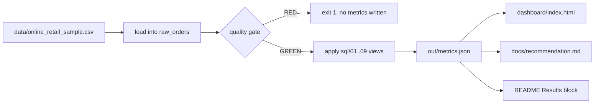

# SPEC: retail metrics acceptance

## Problem

Stakeholders ask for metrics in sentences ("what share of revenue comes from repeat customers?"). Analysts answer with a query and a screenshot, and nobody can tell later whether the number was right or whether the data underneath it was sound. This repo treats each requirement as an executable acceptance test over a SQL metrics layer, so a requirement is either proven by a passing test id or listed as a gap.

Data: 15,000-row fixed-seed sample of UCI Online Retail (see `data/SOURCE.md`). Stack: Python 3.11 stdlib, sqlite3, pytest.

## Binary exits

| Id | Command | Pass condition |
|----|---------|----------------|
| E1 | `make test` | exit 0, all tests pass |
| E2 | `make selftest` | exit 0 only if the planted duplicate key and the planted NULL join key both turn the quality gate RED and the clean sample stays GREEN |
| E3 | `make regen` twice | `git diff --stat` empty after the second run |
| E4 | `pytest tests/test_docs.py::test_readme_results_block_drift` | README Results block equals generated block |
| E5 | banned-word grep | prints nothing (dataset product descriptions exempt) |
| E6 | `pytest tests/test_docs.py::test_trace_table_proven_rows_have_existing_tests` | every PROVEN row names a test id that exists |
| E7 | `git status --short` | empty, one author identity in history |

## Requirement-to-test trace

Counts are out of 10 US-remote postings per title (Data Analyst, Business Analyst, Operations Analyst), sampled 2026-11-17; company names not recorded. Rows are ordered by highest count, PROVEN rows first.

| Requirement | Seen in N/10 postings | File | Test id | Status |
|-------------|-----------------------|------|---------|--------|
| Dashboards / reporting | data 10/10, business 7/10, operations 10/10 | `dashboard/index.html` | `tests/test_acceptance.py::test_us8_dashboard_numbers_match_metrics` | PROVEN |
| Stakeholder requirements / cross-functional | data 8/10, business 10/10, operations 7/10 | `docs/requirements.md` | `tests/test_docs.py::test_every_story_names_an_existing_test` | PROVEN |
| SQL | data 10/10, business 3/10, operations 4/10 | `sql/05_monthly_revenue.sql` ... `sql/09_headline_metrics.sql` | `tests/test_acceptance.py::test_us1_monthly_revenue_matches_independent_sum` | PROVEN |
| Communication | data 7/10, business 9/10, operations 9/10 | `docs/recommendation.md` | `tests/test_docs.py::test_recommendation_matches_regen` | PROVEN |
| Recommendations / insights | data 8/10, business 7/10, operations 4/10 | `docs/recommendation.md` | `tests/test_docs.py::test_recommendation_matches_regen` | PROVEN |
| Python | data 8/10, business 1/10, operations 2/10 | `pipeline/run.py` | `tests/test_pipeline.py::test_main_green_writes_metrics` | PROVEN |
| Process improvement / mapping | data 4/10, business 7/10, operations 7/10 | `docs/requirements.md` (Mermaid process map) | `tests/test_docs.py::test_process_map_present` | PROVEN |
| Documentation / runbooks | data 2/10, business 6/10, operations 5/10 | `docs/RUNBOOK.md` | `tests/test_docs.py::test_runbook_sections_present` | PROVEN |
| Requirements gathering | data 0/10, business 6/10, operations 1/10 | `docs/requirements.md` | `tests/test_docs.py::test_every_story_names_an_existing_test` | PROVEN |
| KPIs and metrics | data 5/10, business 1/10, operations 2/10 | `sql/09_headline_metrics.sql` | `tests/test_acceptance.py::test_us6_average_order_value` | PROVEN |
| ETL / pipelines | data 5/10, business 0/10, operations 1/10 | `pipeline/run.py` | `tests/test_pipeline.py::test_load_row_count_equals_csv` | PROVEN |
| Data quality | data 1/10, business 2/10, operations 3/10 | `pipeline/run.py` quality checks | `tests/test_pipeline.py::test_mutant_disabled_quality_check_lets_fault_through` | PROVEN |
| Agile ticketing | data 1/10, business 6/10, operations 0/10 | none | none | GAP |
| Spreadsheets | data 2/10, business 2/10, operations 4/10 | none | none | GAP |
| A BI tool | data 4/10, business 2/10, operations 0/10 | none | none | GAP |
| A cloud warehouse | data 4/10, business 0/10, operations 0/10 | none | none | GAP |
| Statistics / A-B testing | data 2/10, business 2/10, operations 0/10 | none | none | GAP |

GAP rows are not claimed anywhere in this repo.

## Pipeline DAG

## Quality dimensions used

| Check | Dimension | Rule |
|-------|-----------|------|
| duplicate_order_lines | uniqueness | rows sharing (InvoiceNo, StockCode, InvoiceDate, Quantity, UnitPrice, CustomerID) beyond the first |
| null_join_key | completeness | NULL StockCode on a row with positive quantity and price (an inner join to dim_products would drop its revenue) |
| negative_price | validity | UnitPrice below zero |
| orphan_rows | integrity | rows with positive quantity and price that are absent from clean_orders |

Each check is compared with `data/quality_baseline.json`, the count the vendored sample is known to contain (3 exact duplicate lines, recorded rather than silently removed). The gate is RED when any observed count exceeds its baseline.

## Decisions

- Cancellation rate is invoice based (cancelled invoices over all invoices) and read from `raw_orders`, because `clean_orders` excludes cancellations by design.
- Customers with NULL CustomerID (about a quarter of rows) are excluded from customer metrics (repeat rate, cohorts) and reported as an unattributed revenue share.
- The final month in the sample (2011-12) is partial (data ends 2011-12-09); it is shown, and flagged in Limitations.
- Derived SQL names are snake_case; raw columns keep source names.
- River alignment of keywords is not adopted; uppercase keywords and snake_case names are.
- No hand-typed numbers in README or `docs/recommendation.md`: `make regen` writes them from `out/metrics.json`.

## Standards table

Fetched 2026-11-17. Only lines actually returned by the fetch are quoted.

| Name | URL | Line relied on | Fetched |
|------|-----|----------------|---------|
| Agile Alliance, Given-When-Then | https://www.agilealliance.org/glossary/gwt/ | "The Given-When-Then formula is a template intended to guide the writing of acceptance tests for a User Story." Given = "some context", When = "some action is carried out", Then = "a particular set of observable consequences should obtain." | 2026-11-17 |
| SQL Style Guide (Simon Holywell) | https://www.sqlstyle.guide/ | "Always use uppercase for the reserved keywords like SELECT and WHERE." and "Use underscores where you would naturally include a space in the name (first name becomes first_name)." | 2026-11-17 |
| Wikipedia, Data quality | https://en.wikipedia.org/wiki/Data_quality | Section "Dimensions of data quality" names completeness, validity, uniqueness and conformity or integrity among its dimensions; "Validity refers to the usefulness, accuracy, and correctness of data for its application." | 2026-11-17 |
