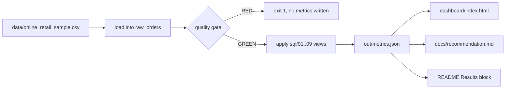

# SPEC: retail metrics acceptance

## Problem

Stakeholders ask for metrics in sentences ("what share of revenue comes from repeat customers?"). Analysts answer with a query and a screenshot, and nobody can tell later whether the number was right or whether the data underneath it was sound. This repo treats each requirement as an executable acceptance test over a SQL metrics layer, so a requirement is either proven by a passing test id or listed as a gap.

Data: 15,000-row fixed-seed sample of UCI Online Retail (see `data/SOURCE.md`). Stack: Python 3.11 stdlib, sqlite3, pytest.

## Binary exits

| Id | Command | Pass condition |
|----|---------|----------------|
| E1 | `make test` | exit 0, all tests pass |
| E2 | `make selftest` | exit 0 only if the planted duplicate key and the planted NULL join key both turn the quality gate RED and the clean sample stays GREEN |
| E3 | `make regen` twice | `git diff --stat` empty after the second run |
| E4 | `pytest tests/test_docs.py::test_readme_results_block_drift` | README Results block equals generated block |
| E5 | banned-word grep | prints nothing (dataset product descriptions exempt) |
| E6 | `pytest tests/test_docs.py::test_trace_table_proven_rows_have_existing_tests` | every PROVEN row names a test id that exists |
| E7 | `git status --short` | empty, one author identity in history |

## Requirement-to-test trace

Counts are out of 10 US-remote postings per title (Data Analyst, Business Analyst, Operations Analyst), sampled 2026-11-17; company names not recorded. Rows are ordered by highest count, PROVEN rows first.

| Requirement | Seen in N/10 postings | File | Test id | Status |
|-------------|-----------------------|------|---------|--------|
| Dashboards / reporting | data 10/10, business 6/10, operations 9/10 | `dashboard/index.html` | `tests/test_acceptance.py::test_us8_dashboard_numbers_match_metrics` | PROVEN |
| Stakeholder requirements / cross-functional | data 8/10, business 10/10, operations 7/10 | `docs/requirements.md` | `tests/test_docs.py::test_every_story_names_an_existing_test` | PROVEN |
| SQL | data 10/10, business 3/10, operations 4/10 | `sql/05_monthly_revenue.sql` ... `sql/09_headline_metrics.sql` | `tests/test_acceptance.py::test_us1_monthly_revenue_matches_independent_sum` | PROVEN |
| Recommendations / insights | data 8/10, business 7/10, operations 4/10 | `docs/recommendation.md` | `tests/test_docs.py::test_recommendation_matches_regen` | PROVEN |
| Python | data 8/10, business 1/10, operations 2/10 | `pipeline/run.py` | `tests/test_pipeline.py::test_main_green_writes_metrics` | PROVEN |
| Process improvement / mapping | data 4/10, business 7/10, operations 7/10 | `docs/requirements.md` (Mermaid process map) | `tests/test_docs.py::test_process_map_present` | PROVEN |
| Documentation / runbooks | data 2/10, business 6/10, operations 5/10 | `docs/RUNBOOK.md` | `tests/test_docs.py::test_runbook_sections_present` | PROVEN |
| Requirements gathering | data 0/10, business 6/10, operations 1/10 | `docs/requirements.md` | `tests/test_docs.py::test_every_story_names_an_existing_test` | PROVEN |
| KPIs and metrics | data 5/10, business 1/10, operations 2/10 | `sql/09_headline_metrics.sql` | `tests/test_acceptance.py::test_us6_average_order_value` | PROVEN |
| ETL / pipelines | data 5/10, business 0/10, operations 1/10 | `pipeline/run.py` | `tests/test_pipeline.py::test_load_row_count_equals_csv` | PROVEN |
| Data quality | data 1/10, business 2/10, operations 3/10 | `pipeline/run.py` quality checks | `tests/test_pipeline.py::test_mutant_disabled_quality_check_lets_fault_through` | PROVEN |
| Communication | data 7/10, business 9/10, operations 9/10 | `docs/recommendation.md` | `tests/test_docs.py::test_recommendation_matches_regen` | PARTIAL: written output, numbers tested; no live presentation |
| Agile ticketing | data 1/10, business 6/10, operations 0/10 | none | none | GAP |
| Spreadsheets | data 2/10, business 2/10, operations 4/10 | none | none | GAP |
| A BI tool | data 4/10, business 2/10, operations 0/10 | none | none | GAP |
| A cloud warehouse | data 4/10, business 0/10, operations 0/10 | none | none | GAP |
| Statistics / A-B testing | data 2/10, business 2/10, operations 0/10 | none | none | GAP |

GAP rows are not claimed anywhere in this repo.

## Pipeline DAG

## Quality dimensions used

| Check | Dimension | Rule |
|-------|-----------|------|
| duplicate_order_lines | uniqueness | rows sharing (InvoiceNo, StockCode, InvoiceDate, Quantity, UnitPrice, CustomerID) beyond the first |
| null_join_key | completeness | NULL StockCode on a row with positive quantity and price (an inner join to dim_products would drop its revenue) |
| negative_price | validity | UnitPrice below zero |
| orphan_rows | integrity | rows with positive quantity and price that are absent from clean_orders |

Each check is compared with `data/quality_baseline.json`, the count the vendored sample is known to contain (3 exact duplicate lines, recorded rather than silently removed). The gate is RED when any observed count exceeds its baseline.

## Decisions

- Cancellation rate is invoice based (cancelled invoices over all invoices) and read from `raw_orders`, because `clean_orders` excludes cancellations by design.
- Customers with NULL CustomerID (about a quarter of rows) are excluded from customer metrics (repeat rate, cohorts) and reported as an unattributed revenue share.
- The final month in the sample (2011-12) is partial (data ends 2011-12-09); it is shown, and flagged in Limitations.
- Derived SQL names are snake_case; raw columns keep source names.
- River alignment of keywords is not adopted; uppercase keywords and snake_case names are.
- No hand-typed numbers in README or `docs/recommendation.md`: `make regen` writes them from `out/metrics.json`.
- Every file read or written by `pipeline/` names `encoding="utf-8"`, so the outputs do not depend on the locale (`tests/test_entrypoints.py::test_run_script_output_is_identical_under_the_strictest_c_locale`, `tests/test_pipeline.py::test_every_text_io_call_in_pipeline_names_its_encoding`).
- `pipeline/run.py` refuses a file with no clean order lines (all cancelled, zero price only, header only): it prints `no clean order lines; nothing to report`, exits 1 and writes nothing (`tests/test_entrypoints.py::test_scripts_refuse_a_file_with_no_clean_order_lines`).
- The loader fails with one `ValueError` naming the row and column for a blank or non-integer Quantity, a blank, non-numeric or non-finite UnitPrice, and an InvoiceDate that is not `YYYY-MM-DD HH:MM:SS`; a file that is not UTF-8 names the line. The committed sample has none of these (`tests/test_pipeline.py::test_loader_names_the_row_and_column_of_a_bad_cell`).
- Loader cells are checked on the raw text, ASCII only: a date with a leading or trailing space, a one-digit month, day, hour, minute or second, a two-digit year, or any non-ASCII digit (Arabic-Indic, fullwidth) in Quantity, UnitPrice or InvoiceDate is refused. UnitPrice `inf`, `-inf` and `nan` in any letter case are refused. The message is exactly `row N, column C: 'raw' is not a valid value` (`test_bad_cell_message_is_exactly_row_column_value_is_not_a_valid_value`).
- The loader raises with no exception chain: `__cause__` is None and `__suppress_context__` is True, for a bad cell and for a non-UTF-8 file (`test_bad_cell_error_carries_no_exception_chain`, `test_non_utf_8_error_carries_no_exception_chain`).
- A non-UTF-8 file fails with `<path>: not valid UTF-8 at line N`, N counted by line feed: a CRLF or LF file names the physical line, a CR-only file has no line feed and reports line 1 (`test_non_utf_8_error_counts_lines_by_line_feed`).
- Header and field-count rules: a data row with more or fewer fields than the header fails with `<path>: row N: expected W fields, found K` (W is the header width, 9 for a header with one extra column; N is the file row, the first data row is 2; K counts blank cells); a duplicate column fails with `<path>: duplicate column 'X'`; a missing required column fails with `<path>: missing column(s): A, B`; an extra unknown column is accepted and ignored; a UTF-8 byte order mark at the start is stripped and the metrics equal the run without it (`test_a_row_with_more_fields_than_the_header_names_the_file_and_row`, `test_a_duplicate_column_name_is_rejected`, `test_a_missing_required_column_is_named`, `test_an_extra_unknown_column_is_accepted_and_ignored`, `test_a_utf_8_byte_order_mark_is_stripped_and_the_metrics_are_unchanged`).
- Header faults are decided before any row: a duplicated column is refused even when it is an unknown extra column (`duplicate column 'Extra'`); each of the eight required columns alone is reported by name, several in header order (`Quantity, CustomerID`, not alphabetical); a bad cell after a byte order mark names its file row; only a mark at the very start of the file is stripped, a mark at the start of a later line stays in the cell (`test_only_a_byte_order_mark_at_the_start_of_the_file_is_stripped`, `test_a_duplicated_unknown_extra_column_is_rejected`, `test_a_header_missing_exactly_one_required_column_names_it`, `test_missing_columns_are_named_in_header_order_not_alphabetically`, `test_the_field_count_message_uses_the_header_width_not_a_fixed_eight`, `test_a_short_row_counts_blank_cells_as_fields`, `test_a_long_row_counts_blank_cells_as_fields`, `test_the_field_count_row_number_is_the_file_row_wherever_it_sits`, `test_a_bad_cell_after_a_byte_order_mark_names_its_file_row`).
- A blank InvoiceNo loads as the empty string, not NULL (StockCode, Description and CustomerID blanks load as NULL); a UnitPrice of `-0.0` is a zero price (not negative, excluded from clean_orders) (`test_a_blank_invoice_number_loads_as_empty_text_not_null`, `test_a_negative_zero_price_is_a_zero_price_not_a_negative_one`).
- Quoted newlines inside a Description (LF, CRLF, lone CR) load as one row, and a CR-only file loads every row (`test_a_quoted_newline_in_a_description_loads_as_one_row`, `test_a_file_with_carriage_return_only_line_ends_loads_every_row`). Dropping `newline=""` from the in-memory reader is not equivalent: a CR-only file then raises a csv error (probed), so the pin kills it.
- Decoding with the default codec instead of `utf-8-sig` is not equivalent either: the default keeps a leading byte order mark and the file then lacks its `InvoiceNo` column (the BOM test is red against it). Before the BOM fix `decode()` and `decode("utf-8")` were equivalent, because `bytes.decode` defaults to UTF-8; probed on valid, invalid and BOM input with identical results.
- `customer_order_windows.running_customer_revenue` restarts for every customer; the total of one customer never carries into the next (`test_running_customer_revenue_restarts_for_every_customer`). Matching the date pattern from the start only (`match` for `fullmatch`) is equivalent: `strptime` refuses any trailing text, probed on a trailing line feed, space, NUL and space plus line feed with the same refusal.
- When the quality gate fails and the file also has no clean order lines, the gate failure is reported (`GATE RED: no metrics written`, exit 1) and the empty-result message is not printed; a file with exactly one clean line is reported normally (`test_a_failed_gate_is_reported_before_the_no_clean_lines_refusal`, `test_a_file_with_exactly_one_clean_line_is_not_refused`). The refusal line is exactly `no clean order lines; nothing to report`.
- `make regen` accepts a file with no attributed customers (no cohorts) and a file covering a single month (`test_regen_accepts_data_with_no_attributed_customers`, `test_regen_accepts_a_file_that_covers_a_single_month`).
- Test code names `encoding="utf-8"` on every text open, read_text and write_text, so the suite does not depend on the locale (`tests/test_test_hygiene.py`). The published-file guard watches every file under `out/`, `dashboard/` and `docs/` at any depth. The Makefile has no `.IGNORE`, no `SHELL` assignment, no special target except `.PHONY`, no prerequisites on any target and no recipe line starting with `-`; the CI file uses `actions/checkout@v4` and `actions/setup-python@v5`, has no node setup, no `if:`, no `env:` and no `--collect-only` (`tests/test_makefile.py`).

## Standards table

Fetched 2026-11-17. Only lines actually returned by the fetch are quoted.

| Name | URL | Line relied on | Fetched |
|------|-----|----------------|---------|
| Agile Alliance, Given-When-Then | https://www.agilealliance.org/glossary/gwt/ | "The Given-When-Then formula is a template intended to guide the writing of acceptance tests for a User Story." Given = "some context", When = "some action is carried out", Then = "a particular set of observable consequences should obtain." | 2026-11-17 |
| SQL Style Guide (Simon Holywell) | https://www.sqlstyle.guide/ | "Always use uppercase for the reserved keywords like SELECT and WHERE." and "Use underscores where you would naturally include a space in the name (first name becomes first_name)." | 2026-11-17 |
| Wikipedia, Data quality | https://en.wikipedia.org/wiki/Data_quality | Section "Dimensions of data quality" names completeness, validity, uniqueness and conformity or integrity among its dimensions; "Validity refers to the usefulness, accuracy, and correctness of data for its application." | 2026-11-17 |
