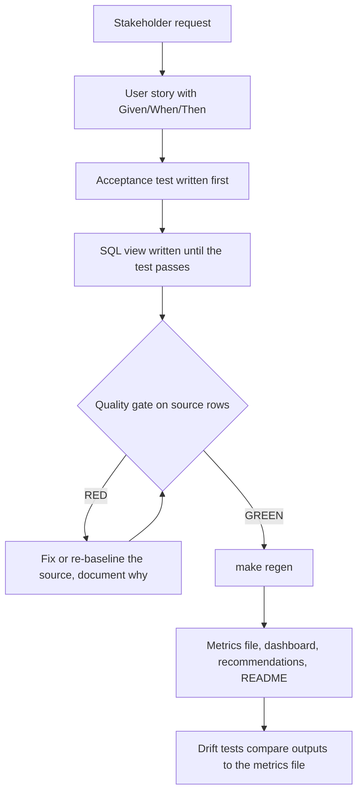

# Requirements and acceptance criteria

Each story uses Given/When/Then, the template for acceptance tests described by the Agile Alliance (see `SPEC.md`). The listed test id is the pytest function that executes the criteria.

## US1 Monthly revenue trend

As a finance lead I need monthly revenue with month-over-month change and a running total so that I can see the trend without rebuilding it by hand.

- Given the cleaned order lines (positive quantity, positive price, product key present)
- When revenue is grouped by invoice month
- Then each month equals an independent sum from the CSV, the first month has no change figure, every later change equals (this - previous) / previous, and the last running total equals total revenue.

Tests: `tests/test_acceptance.py::test_us1_monthly_revenue_matches_independent_sum`, `tests/test_acceptance.py::test_us1_month_over_month_change`, `tests/test_acceptance.py::test_us1_running_total_ends_at_total_revenue`

## US2 Top products per country

As a merchandising lead I need the top three products by revenue in each of the largest countries so that I can see what to keep in stock for each market.

- Given the cleaned order lines with each customer's primary country
- When products are ranked by revenue inside each country
- Then the three largest countries each list three products that match an independent ranking, ties broken by stock code.

Tests: `tests/test_acceptance.py::test_us2_top3_products_per_country`

## US3 Repeat-purchase rate

As a CRM lead I need the share of identified customers who ordered more than once, and the revenue they bring, so that I can size the repeat base.

- Given customers with a customer ID
- When orders are counted per customer
- Then the repeat rate and the repeat revenue share equal independent calculations.

Tests: `tests/test_acceptance.py::test_us3_repeat_purchase_rate`

## US4 Cohort retention

As a CRM lead I need monthly cohort retention so that I can see how many customers return after their first order.

- Given each customer's first order month
- When activity is counted by months since that month
- Then month 0 is 100 percent, cohort sizes sum to the customer count, and each retention figure equals an independent count.

Tests: `tests/test_acceptance.py::test_us4_cohort_retention`

## US5 Cancellation rate

As an operations lead I need the share of invoices that are cancellations, overall and by month, so that I can see when returns spike.

- Given all invoices including cancellations (invoice number starts with C)
- When cancelled invoices are divided by all invoices
- Then the overall and monthly rates equal independent calculations.

Tests: `tests/test_acceptance.py::test_us5_cancellation_rate`

## US6 Average order value

As a finance lead I need average order value so that I can track basket size.

- Given the cleaned order lines
- When revenue is divided by distinct orders
- Then the overall and first-month values equal independent calculations.

Tests: `tests/test_acceptance.py::test_us6_average_order_value`

## US7 Bad data stops the pipeline

As a data steward I need duplicate keys and NULL join keys to stop the pipeline so that no report is built on silently wrong revenue.

- Given the vendored sample
- When a duplicate order line, or a NULL product key on a sold line, is planted
- Then the quality gate is RED and no metrics file is written, and the unmodified sample is GREEN with zero revenue gap.

Tests: `tests/test_acceptance.py::test_us7_quality_gate_green_on_vendored_sample`, `tests/test_acceptance.py::test_us7_planted_duplicate_turns_gate_red`, `tests/test_acceptance.py::test_us7_planted_null_key_turns_gate_red`

## US8 Dashboard shows the metrics file

As an executive reader I need a dashboard whose numbers equal the metrics file so that I can trust what I see.

- Given out/metrics.json
- When the dashboard is generated
- Then every number on the page sits in an element tied to a metrics path and equals that value, the page loads no external asset and has no script.

Tests: `tests/test_acceptance.py::test_us8_dashboard_numbers_match_metrics`

## Process map

How a request becomes a trusted number.

